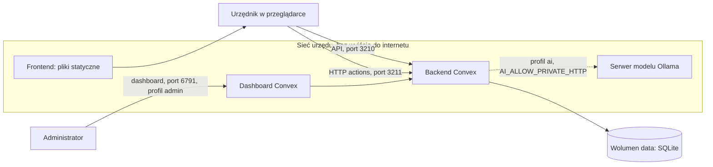

# Wdrożenie on-premise (bez chmury)

Ta instrukcja opisuje uruchomienie aplikacji w sieci urzędu, bez wyjścia do internetu po stronie backendu. Backend działa jako self-hosted Convex w Docker Compose. Wariant chmurowy (Convex Cloud, Vercel) opisuje [docs/deployment.md](deployment.md).

## Status

| Część                                                   | Stan                                                                                                                                                                                                              |
| ------------------------------------------------------- | ----------------------------------------------------------------------------------------------------------------------------------------------------------------------------------------------------------------- |
| Backend Convex w `docker-compose.yml` (profil domyślny) | Zweryfikowany: start, zdrowy kontener, wdrożenie funkcji, trwałość danych po `down` i `up`.                                                                                                                       |
| Frontend na serwerze urzędu                             | Do ustalenia. Dockerfile frontu to osobne issue. Build z `VITE_CONVEX_URL` działa lokalnie.                                                                                                                       |
| Dashboard Convex (profil `admin`)                       | Uruchamiany, nie testowany w pełnym przebiegu.                                                                                                                                                                    |
| Lokalny model AI (profil `ai`)                          | Usługa istnieje. Od [#26](https://github.com/Orfeliny/Hacknation-2026/issues/26) Convex łączy się z `http://llm:11434/v1` po ustawieniu `AI_ALLOW_PRIVATE_HTTP=true`. Pełny przebieg z modelem nie był testowany. |

## Architektura i przepływ danych



Żadna usługa z `docker-compose.yml` nie wysyła danych do internetu. Wyjątek to telemetria Convex (beacon), patrz [Zabezpieczenia](#zabezpieczenia-przed-produkcją).

## Wymagania

- Docker z Compose v2 (Docker Desktop na Windows i macOS, Docker Engine na Linuksie).
- Node.js 24.15 lub nowszy i npm. Potrzebne do `npx convex deploy` i builda frontu.
- Wolne porty na serwerze: 3210 i 3211 (dostęp z sieci urzędu), 6791 (tylko administrator, profil `admin`).
- Zasoby sprzętowe (RAM, dysk): do uzupełnienia po pomiarze na docelowym sprzęcie.

## Instrukcja uruchomienia

Wszystkie polecenia wykonuj w katalogu repozytorium.

**1. Przygotuj plik z wartościami.** Skopiuj szablon i uzupełnij wartości:

```powershell
Copy-Item .env.docker.example .env.docker.local
```

W `.env.docker.local` ustaw:

- `INSTANCE_NAME`: dowolna nazwa instancji, bez spacji.
- `INSTANCE_SECRET`: 32 losowe bajty w hex. Komenda jest w komentarzu szablonu. Nie wklejaj tej wartości do repo ani do czatu.
- `CONVEX_CLOUD_ORIGIN` i `CONVEX_SITE_ORIGIN`: adresy, pod którymi backend widzi przeglądarka w sieci urzędu, np. `http://10.0.0.5:3210` i `http://10.0.0.5:3211`. Dla jednej maszyny zostaw `127.0.0.1`.

**2. Uruchom backend:**

```powershell
docker compose --env-file .env.docker.local up -d backend
docker compose --env-file .env.docker.local ps
```

W kolumnie `STATUS` kontener powinien mieć `healthy`. Pierwsze uruchomienie pobiera obrazy, więc trwa dłużej.

**3. Wygeneruj klucz admina:**

```powershell
docker compose --env-file .env.docker.local exec backend ./generate_admin_key.sh
```

Zapisz wynik w pliku `.env.local` jako `CONVEX_SELF_HOSTED_ADMIN_KEY`. Dodaj tam też `CONVEX_SELF_HOSTED_URL=http://127.0.0.1:3210`. Plik `.env.local` nie trafia do Gita. Klucz nie może trafić do repo ani do czatu.

**4. Wgraj funkcje i ustaw tryb AI:**

```powershell
npm ci
npx convex deploy
npx convex env set AI_PROVIDER mock
```

Tryb `mock` jest domyślny i nie wymaga internetu ani modelu.

**5. Uruchom frontend.** W `.env.local` ustaw `VITE_CONVEX_URL` na adres backendu widziany przez przeglądarkę, np. `http://10.0.0.5:3210`, i uruchom `npm run dev:frontend`. To serwer deweloperski, do testu, nie do produkcji. Stałe serwowanie frontu w urzędzie ustala osobne issue (Dockerfile frontu).

**6. Sprawdź działanie.** Otwórz aplikację w przeglądarce. Baner „Tryb offline” nie powinien się pojawić, a lista notatek powinna się wczytać.

## Kopia zapasowa

Dane backendu leżą w wolumenie Dockera `hacknation-2026_data`. Nazwa zależy od nazwy katalogu repo; sprawdź ją poleceniem `docker volume ls`.

Procedurę przetestowano w Git Bash (Windows):

```bash
docker compose --env-file .env.docker.local stop backend
MSYS_NO_PATHCONV=1 docker run --rm -v hacknation-2026_data:/data:ro -v "$PWD/backup:/backup" alpine tar czf /backup/convex-data.tgz -C /data .
docker compose --env-file .env.docker.local start backend
```

Uwagi:

- Przed kopią zatrzymaj backend. Kopia działającej bazy SQLite może być niespójna.
- Archiwum zawiera `credentials/instance_secret`. Traktuj je jak sekret: nie wrzucaj do repo, nie wysyłaj poza urząd.
- Przywracanie z archiwum nie zostało jeszcze przetestowane. Zrób to przed wdrożeniem produkcyjnym.

## Aktualizacja wersji

Obrazy są przypięte do digestów w `docker-compose.yml`, nie do `:latest`. Obecny backend odpowiada release `precompiled-2026-11-20-3d58575` (etykieta `org.opencontainers.image.revision` = `3d585751…`). Aktualizacja:

1. Zrób kopię zapasową wolumenu (sekcja wyżej).
2. Zmień digest w `docker-compose.yml` w osobnym PR-ze.
3. Pobierz i uruchom ponownie: `docker compose --env-file .env.docker.local pull backend` oraz `up -d backend`.
4. Sprawdź `healthy` i wdróż funkcje ponownie, jeśli zmieniła się wersja Convex.

## Zabezpieczenia przed produkcją

Starter nie jest gotowy do produkcji. Poniższa lista mówi, co trzeba zrobić przed użyciem z prawdziwymi danymi.

| Obszar                    | Stan w starterze                                                                                                                                                                                                 | Co zrobić przed produkcją                                                                                             |
| ------------------------- | ---------------------------------------------------------------------------------------------------------------------------------------------------------------------------------------------------------------- | --------------------------------------------------------------------------------------------------------------------- |
| Logowanie użytkowników    | Serwer Keycloak w profilu `auth` (sekcja „Logowanie (Keycloak)”); logowanie w aplikacji dochodzi w kolejnych PR-ach [#42](https://github.com/Orfeliny/Hacknation-2026/issues/42). Do tego czasu przełącznik ról. | Włącz logowanie, użyj wariantu produkcyjnego Keycloaka i podłącz Active Directory.                                    |
| Dostęp do API             | Porty 3210 i 3211 są otwarte na wszystkich interfejsach serwera.                                                                                                                                                 | Ogranicz zaporą do stacji urzędników.                                                                                 |
| Szyfrowanie w transporcie | HTTP.                                                                                                                                                                                                            | Reverse proxy z HTTPS wewnątrz sieci urzędu.                                                                          |
| Sekrety                   | `INSTANCE_SECRET` i klucz admina poza repo.                                                                                                                                                                      | Przechowuj w menedżerze haseł urzędu. Rotuj po odejściu członka zespołu.                                              |
| Dashboard                 | Profil `admin`, port 6791.                                                                                                                                                                                       | Uruchamiaj tylko na stacji administratora, zaporą ogranicz dostęp.                                                    |
| Kopie zapasowe            | Procedura ręczna (sekcja wyżej).                                                                                                                                                                                 | Harmonogram i test przywracania.                                                                                      |
| Dane osobowe i retencja   | Brak polityki.                                                                                                                                                                                                   | Uzgodnić z inspektorem ochrony danych urzędu.                                                                         |
| Logi i audyt              | Logi kontenera, dziennik audytu i rejestr użycia AI w bazie ([#39](https://github.com/Orfeliny/Hacknation-2026/issues/39)).                                                                                      | Ustalić z urzędem okres przechowywania wpisów audytu.                                                                 |
| Telemetria                | Backend domyślnie komunikuje się z serwerem beacon Convex (log startu to pokazuje).                                                                                                                              | Dodaj `DISABLE_BEACON=true` do `environment` usługi `backend` w `docker-compose.yml`. Zmiana nie jest jeszcze w repo. |
| Monitoring błędów         | Sentry wyłączony, `VITE_SENTRY_DSN` pusty.                                                                                                                                                                       | Włączać tylko z własnym, dopuszczonym w urzędzie projektem.                                                           |

## Tryb bez AI i z lokalnym modelem

- **`mock`** (domyślny): odpowiedzi testowe, bez modelu i bez internetu. Wystarczy do demo i do sprawdzenia całego przepływu.
- **Lokalny model** (np. Bielik lub PLLuM przez Ollama): profil `ai` w `docker-compose.yml` uruchamia serwer. Convex łączy się z nim po włączeniu flagi z [#26](https://github.com/Orfeliny/Hacknation-2026/issues/26):

  ```bash
  npx convex env set AI_PROVIDER openai-compatible
  npx convex env set AI_BASE_URL http://llm:11434/v1
  npx convex env set AI_ALLOW_PRIVATE_HTTP true
  npx convex env set AI_MODEL <nazwa modelu w Ollama>
  npx convex env set AI_API_KEY <dowolna wartość, Ollama jej nie sprawdza>
  ```

  Szczegóły i wariant vLLM: [docs/ai-providers.md](ai-providers.md), sekcja „Lokalny model w sieci urzędu”. Mały urząd bez serwera może zostać przy `mock` albo użyć hostowanego endpointu `https` z pseudonimizacją.

## Logowanie (Keycloak)

Plan i uzasadnienia: [specs/oidc-keycloak.md](../specs/oidc-keycloak.md), issue [#42](https://github.com/Orfeliny/Hacknation-2026/issues/42). Ta sekcja opisuje serwer logowania. Logowanie w samej aplikacji dochodzi w kolejnych PR-ach tego issue; do tego czasu aplikacja używa przełącznika ról (tryb `demo`).

### Uruchomienie lokalne i demo

Profil `auth` w `docker-compose.yml` uruchamia Keycloaka (obraz przypięty do digestu, tryb `start-dev`) i importuje realm `azymut` z `deploy/keycloak/realm-demo.json`: klient publiczny `azymut-web` (kod autoryzacji z PKCE), role `hr`, `director`, `admin` i pięciu użytkowników demo, którzy odpowiadają osobom z danych demo (te same adresy e-mail). Role „przełożony” i „oceniany” nie są rolami Keycloaka: oceniany to każdy powiązany pracownik, a przełożony wynika z danych kadrowych.

1. Ustaw zmienne z `deploy/keycloak/env.example` w tym samym pliku, który podajesz w `--env-file`: `KEYCLOAK_ADMIN_PASSWORD` i `KEYCLOAK_DEMO_PASSWORD`. Oba są wymagane i nie mają wartości domyślnych. Hasło demo jest wspólne dla wszystkich użytkowników demo, więc używaj go tylko lokalnie.
2. Dodaj do pliku hosts wpis `127.0.0.1 keycloak` (Windows: `C:\Windows\System32\drivers\etc\hosts`, wymaga uprawnień administratora). Przeglądarka musi widzieć Keycloaka pod tą samą nazwą, którą Keycloak wpisuje w tokeny jako `iss` (zmienna `KC_HOSTNAME`, domyślnie `http://keycloak:8080`); backend Convex widzi go pod tą nazwą w sieci Compose.
3. Uruchom: `docker compose --env-file .env.docker.local --profile auth up -d keycloak`.
4. Sprawdź: `http://keycloak:8080/realms/azymut/.well-known/openid-configuration` zwraca konfigurację, a konsola administratora jest pod `http://keycloak:8080` (login `admin`, hasło z kroku 1).

`start-dev` służy tylko do lokalnego użytku: ma niezabezpieczone ustawienia domyślne, a dane żyją w kontenerze. Import realmu odbywa się przy starcie i pomija realm, który już istnieje.

### Wariant produkcyjny

Zalecenia Keycloaka dla produkcji: `start --optimized` po kroku `build`, wyłącznie https, ustawiony `KC_HOSTNAME`, prawdziwa baza danych (nie plik H2), limit pamięci (ok. 2 GB), hasło administratora tylko z zmiennych środowiskowych. Nie importuj użytkowników demo na serwerze dostępnym spoza sieci lokalnej: załóż prawdziwe konta albo podłącz Active Directory (niżej). Pole `iss` musi być identyczne z domeną w konfiguracji logowania Convex, więc ustaw `KEYCLOAK_PUBLIC_URL` na adres, którym urzędnicy naprawdę wchodzą do Keycloaka.

Keycloak nie ma wbudowanego logowania linkiem ani kodem z e-maila. Wariant bazowy to e-mail i hasło: konta zakłada się z listy kadr, adres e-mail jest potwierdzany, a hasło użytkownik ustawia przez link z wiadomości „zaktualizuj hasło” (wymaga ustawienia serwera SMTP w realmie).

### Active Directory

Duże urzędy mają Active Directory i mogą go podłączyć do Keycloaka, zamiast zakładać konta ręcznie:

1. W konsoli administratora: _User federation_ → dodaj dostawcę **LDAP**, producent „Active Directory”. Podaj adres (`ldap://` albo `ldaps://`), konto do wiązania i katalog użytkowników.
2. Keycloak importuje profile użytkowników i mapuje atrybuty, ale **nigdy nie importuje haseł**: hasło jest sprawdzane w AD przy każdym logowaniu. Uruchom jednorazowo synchronizację wszystkich użytkowników, a potem włącz okresową synchronizację zmian.
3. Tryb edycji (tylko do odczytu, zapis, niesynchronizowany) określa, czy Keycloak może zapisywać zmiany z powrotem do AD. Dla Azymutu wystarczy **tylko do odczytu**.
4. Pojedyncze logowanie (SSO) przez Kerberos: włącz w dostawcy LDAP opcję uwierzytelniania Kerberos albo dodaj osobnego dostawcę Kerberos, utwórz nazwę główną usługi `HTTP/<host>` z plikiem keytab i `krb5.conf`, i włącz SPNEGO w przepływie logowania przeglądarki. Bez tego użytkownik wpisuje hasło AD na stronie Keycloaka.
5. Role `hr`, `director` i `admin` nadaje administrator w Keycloaku (przypisanie roli użytkownikowi lub grupie z AD). Azymut wiąże konto z pracownikiem po zweryfikowanym adresie e-mail, więc adres w AD musi się zgadzać z adresem w danych kadrowych.

Szczegóły i opcje: [dokumentacja administratora Keycloaka](https://www.keycloak.org/docs/latest/server_admin/index.html).

## Zobacz też

- [docs/deployment.md](deployment.md): wariant chmurowy.
- [docs/ai-providers.md](ai-providers.md): dostawcy AI i zmienne Convex.
- [docs/architecture.md](architecture.md): struktura repozytorium.
- [docs/wyzwanie/asystent-ocen-okresowych.md](wyzwanie/asystent-ocen-okresowych.md): wymagania wyzwania dotyczące wdrożenia w urzędach.
- [specs/starter-architecture.md](../specs/starter-architecture.md) §10.4: decyzje architektoniczne dla wariantu on-premise.
