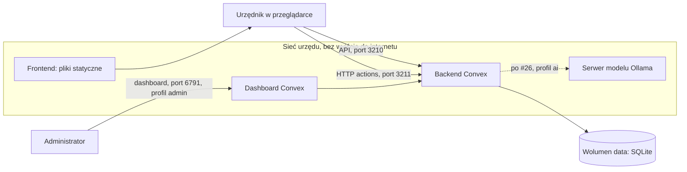

# Wdrożenie on-premise (bez chmury)

Ta instrukcja opisuje uruchomienie aplikacji w sieci urzędu, bez wyjścia do internetu po stronie backendu. Backend działa jako self-hosted Convex w Docker Compose. Wariant chmurowy (Convex Cloud, Vercel) opisuje [docs/deployment.md](deployment.md).

## Status

| Część                                                   | Stan                                                                                                                                                                    |
| ------------------------------------------------------- | ----------------------------------------------------------------------------------------------------------------------------------------------------------------------- |
| Backend Convex w `docker-compose.yml` (profil domyślny) | Zweryfikowany: start, zdrowy kontener, wdrożenie funkcji, trwałość danych po `down` i `up`.                                                                             |
| Frontend na serwerze urzędu                             | Do ustalenia. Dockerfile frontu to osobne issue. Build z `VITE_CONVEX_URL` działa lokalnie.                                                                             |
| Dashboard Convex (profil `admin`)                       | Uruchamiany, nie testowany w pełnym przebiegu.                                                                                                                          |
| Lokalny model AI (profil `ai`)                          | Usługa istnieje, ale Convex nie łączy się z `http://` poza `localhost`. Do czasu [#26](https://github.com/Orfeliny/Hacknation-2026/issues/26) działa tylko tryb `mock`. |

## Architektura i przepływ danych



Żadna usługa z `docker-compose.yml` nie wysyła danych do internetu. Wyjątek to telemetria Convex (beacon), patrz [Zabezpieczenia](#zabezpieczenia-przed-produkcją).

## Wymagania

- Docker z Compose v2 (Docker Desktop na Windows i macOS, Docker Engine na Linuksie).
- Node.js 24.15 lub nowszy i npm. Potrzebne do `npx convex deploy` i builda frontu.
- Wolne porty na serwerze: 3210 i 3211 (dostęp z sieci urzędu), 6791 (tylko administrator, profil `admin`).
- Zasoby sprzętowe (RAM, dysk): do uzupełnienia po pomiarze na docelowym sprzęcie.

## Instrukcja uruchomienia

Wszystkie polecenia wykonuj w katalogu repozytorium.

**1. Przygotuj plik z wartościami.** Skopiuj szablon i uzupełnij wartości:

```powershell
Copy-Item .env.docker.example .env.docker.local
```

W `.env.docker.local` ustaw:

- `INSTANCE_NAME`: dowolna nazwa instancji, bez spacji.
- `INSTANCE_SECRET`: 32 losowe bajty w hex. Komenda jest w komentarzu szablonu. Nie wklejaj tej wartości do repo ani do czatu.
- `CONVEX_CLOUD_ORIGIN` i `CONVEX_SITE_ORIGIN`: adresy, pod którymi backend widzi przeglądarka w sieci urzędu, np. `http://10.0.0.5:3210` i `http://10.0.0.5:3211`. Dla jednej maszyny zostaw `127.0.0.1`.

**2. Uruchom backend:**

```powershell
docker compose --env-file .env.docker.local up -d backend
docker compose --env-file .env.docker.local ps
```

W kolumnie `STATUS` kontener powinien mieć `healthy`. Pierwsze uruchomienie pobiera obrazy, więc trwa dłużej.

**3. Wygeneruj klucz admina:**

```powershell
docker compose --env-file .env.docker.local exec backend ./generate_admin_key.sh
```

Zapisz wynik w pliku `.env.local` jako `CONVEX_SELF_HOSTED_ADMIN_KEY`. Dodaj tam też `CONVEX_SELF_HOSTED_URL=http://127.0.0.1:3210`. Plik `.env.local` nie trafia do Gita. Klucz nie może trafić do repo ani do czatu.

**4. Wgraj funkcje i ustaw tryb AI:**

```powershell
npm ci
npx convex deploy
npx convex env set AI_PROVIDER mock
```

Tryb `mock` jest domyślny i nie wymaga internetu ani modelu.

**5. Uruchom frontend.** W `.env.local` ustaw `VITE_CONVEX_URL` na adres backendu widziany przez przeglądarkę, np. `http://10.0.0.5:3210`, i uruchom `npm run dev:frontend`. To serwer deweloperski, do testu, nie do produkcji. Stałe serwowanie frontu w urzędzie ustala osobne issue (Dockerfile frontu).

**6. Sprawdź działanie.** Otwórz aplikację w przeglądarce. Baner „Tryb offline” nie powinien się pojawić, a lista notatek powinna się wczytać.

## Kopia zapasowa

Dane backendu leżą w wolumenie Dockera `hacknation-2026_data`. Nazwa zależy od nazwy katalogu repo; sprawdź ją poleceniem `docker volume ls`.

Procedurę przetestowano w Git Bash (Windows):

```bash
docker compose --env-file .env.docker.local stop backend
MSYS_NO_PATHCONV=1 docker run --rm -v hacknation-2026_data:/data:ro -v "$PWD/backup:/backup" alpine tar czf /backup/convex-data.tgz -C /data .
docker compose --env-file .env.docker.local start backend
```

Uwagi:

- Przed kopią zatrzymaj backend. Kopia działającej bazy SQLite może być niespójna.
- Archiwum zawiera `credentials/instance_secret`. Traktuj je jak sekret: nie wrzucaj do repo, nie wysyłaj poza urząd.
- Przywracanie z archiwum nie zostało jeszcze przetestowane. Zrób to przed wdrożeniem produkcyjnym.

## Aktualizacja wersji

Obrazy są przypięte do digestów w `docker-compose.yml`, nie do `:latest`. Obecny backend odpowiada release `precompiled-2026-11-20-3d58575` (etykieta `org.opencontainers.image.revision` = `3d585751…`). Aktualizacja:

1. Zrób kopię zapasową wolumenu (sekcja wyżej).
2. Zmień digest w `docker-compose.yml` w osobnym PR-ze.
3. Pobierz i uruchom ponownie: `docker compose --env-file .env.docker.local pull backend` oraz `up -d backend`.
4. Sprawdź `healthy` i wdróż funkcje ponownie, jeśli zmieniła się wersja Convex.

## Zabezpieczenia przed produkcją

Starter nie jest gotowy do produkcji. Poniższa lista mówi, co trzeba zrobić przed użyciem z prawdziwymi danymi.

| Obszar                    | Stan w starterze                                                                    | Co zrobić przed produkcją                                                                                             |
| ------------------------- | ----------------------------------------------------------------------------------- | --------------------------------------------------------------------------------------------------------------------- |
| Logowanie użytkowników    | Brak. Notatki są publiczne.                                                         | SSO lub AD. Patrz [#42](https://github.com/Orfeliny/Hacknation-2026/issues/42) (OIDC przez Keycloak).                 |
| Dostęp do API             | Porty 3210 i 3211 są otwarte na wszystkich interfejsach serwera.                    | Ogranicz zaporą do stacji urzędników.                                                                                 |
| Szyfrowanie w transporcie | HTTP.                                                                               | Reverse proxy z HTTPS wewnątrz sieci urzędu.                                                                          |
| Sekrety                   | `INSTANCE_SECRET` i klucz admina poza repo.                                         | Przechowuj w menedżerze haseł urzędu. Rotuj po odejściu członka zespołu.                                              |
| Dashboard                 | Profil `admin`, port 6791.                                                          | Uruchamiaj tylko na stacji administratora, zaporą ogranicz dostęp.                                                    |
| Kopie zapasowe            | Procedura ręczna (sekcja wyżej).                                                    | Harmonogram i test przywracania.                                                                                      |
| Dane osobowe i retencja   | Brak polityki.                                                                      | Uzgodnić z inspektorem ochrony danych urzędu.                                                                         |
| Logi i audyt              | Logi kontenera. Brak rejestru użycia AI.                                            | Dziennik audytu: [#39](https://github.com/Orfeliny/Hacknation-2026/issues/39).                                        |
| Telemetria                | Backend domyślnie komunikuje się z serwerem beacon Convex (log startu to pokazuje). | Dodaj `DISABLE_BEACON=true` do `environment` usługi `backend` w `docker-compose.yml`. Zmiana nie jest jeszcze w repo. |
| Monitoring błędów         | Sentry wyłączony, `VITE_SENTRY_DSN` pusty.                                          | Włączać tylko z własnym, dopuszczonym w urzędzie projektem.                                                           |

## Tryb bez AI i z lokalnym modelem

- **`mock`** (domyślny): odpowiedzi testowe, bez modelu i bez internetu. Wystarczy do demo i do sprawdzenia całego przepływu.
- **Lokalny model** (np. Bielik lub PLLuM przez Ollama): profil `ai` w `docker-compose.yml` uruchamia serwer, ale Convex nie połączy się z `http://llm:11434/v1` bez zmiany. Zmiana jest opisana w [#26](https://github.com/Orfeliny/Hacknation-2026/issues/26). Do tego czasu nie uruchamiaj `AI_PROVIDER=openai-compatible` w trybie on-premise.

## Zobacz też

- [docs/deployment.md](deployment.md): wariant chmurowy.
- [docs/ai-providers.md](ai-providers.md): dostawcy AI i zmienne Convex.
- [docs/architecture.md](architecture.md): struktura repozytorium.
- [docs/wyzwanie/asystent-ocen-okresowych.md](wyzwanie/asystent-ocen-okresowych.md): wymagania wyzwania dotyczące wdrożenia w urzędach.
- [specs/starter-architecture.md](../specs/starter-architecture.md) §10.4: decyzje architektoniczne dla wariantu on-premise.
