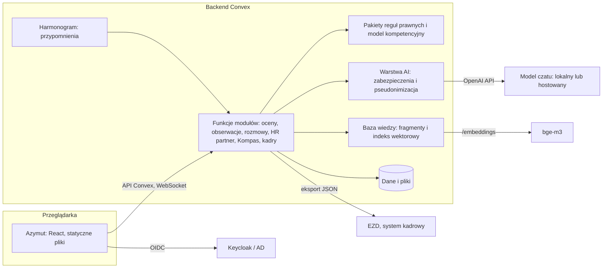

# Architektura i technologie

Krótki opis dla oceniających: z czego Azymut jest zbudowany, jak go wdrożyć w urzędzie, jak aktualizować przepisy i gdzie są punkty integracji. Szczegóły techniczne są w katalogu [`docs/`](..) i w specyfikacjach [`specs/`](../../specs/).

## Technologie

| Warstwa        | Technologia                                                              | Dlaczego                                                                                                   |
| -------------- | ------------------------------------------------------------------------ | ---------------------------------------------------------------------------------------------------------- |
| Interfejs      | React 19, TypeScript (tryb ścisły), Tailwind 4, Vite                     | Popularny, łatwo znaleźć wykonawcę. Statyczne pliki do postawienia na dowolnym serwerze WWW.               |
| Backend i baza | Convex (zapytania, mutacje, akcje, harmonogram, pliki, indeks wektorowy) | Jedna usługa zamiast bazy, API, kolejki i bazy wektorowej. Działa w chmurze albo jako kontener w urzędzie. |
| Walidacja      | Zod na każdej granicy: formularze, zmienne środowiskowe, odpowiedzi AI   | Błędne dane zatrzymują się na wejściu.                                                                     |
| AI             | Adapter zgodny z OpenAI API, tryb `mock`                                 | Dowolny model: lokalny (Bielik, PLLuM w Ollamie lub vLLM) albo hostowany.                                  |
| Embeddingi     | `bge-m3` (1024 wymiary, otwarta licencja)                                | Wielojęzyczny, działa w Ollamie on-premise.                                                                |
| Logowanie      | Keycloak (OIDC), opcjonalnie połączony z Active Directory                | Otwarte oprogramowanie, standard w administracji.                                                          |
| Testy          | Vitest, Testing Library, `convex-test`, Playwright                       | Ponad tysiąc testów jednostkowych i testy e2e w każdym PR.                                                 |

Wszystkie składniki są bezpłatne. Wersje zależności są przypięte co do numeru (`package-lock.json`, obrazy Dockera przypięte skrótem `sha256`).

## Schemat

## Moduły

Każda funkcja ma swój katalog we froncie (`src/features/<nazwa>/`) i w backendzie (`convex/<nazwa>/`). Moduły nie edytują się nawzajem. Pliki wspólne zmienia się tylko w małych, uzgodnionych PR. Dzięki temu poprawkę jednego modułu można wdrożyć bez ruszania reszty.

| Obszar              | Backend                                                                                     |
| ------------------- | ------------------------------------------------------------------------------------------- |
| Proces oceny        | `reviews`, `observations`, `conversations`, `drafting`, `objections`, `signatures`, `print` |
| Terminy i kadry     | `rules`, `deadlineShift`, `hrDashboard`, `employees`, `mail`, `crons.ts`                    |
| Kompas              | `competencies`, `firstReview`, `knowledge`                                                  |
| HR partner i rozwój | `hrPartner`, `growth`, `forum`                                                              |
| Wspólne             | `ai`, `auth`, `audit`, `aiStatus`, `lib`                                                    |

## Przepisy jako dane

Reguły oceny okresowej są w jednym wersjonowanym pakiecie [`convex/rules/pack2016.ts`](../../convex/rules/pack2016.ts) (rozporządzenie z 4.04.2016). Pakiet zawiera arkusze, katalog kryteriów, skalę ocen, długość okresu, terminy etapów i przesłanki przesunięć. Każda reguła ma podstawę prawną. Funkcje liczące przyjmują pakiet jako argument.

Co to daje przy nowelizacji (KPRM zapowiada zmianę ustawy):

- zmiana częstotliwości ocen, terminów czy skali to nowy pakiet danych, a nie przebudowa ekranów,
- stare oceny zostają policzone według pakietu, z którym powstały,
- testy sprawdzają każdą regułę, więc zmiana od razu pokazuje, co się zmieniło w wynikach.

Tak samo działa model kompetencyjny ([`convex/competencies/modelData.ts`](../../convex/competencies/modelData.ts)) i reguły pierwszej oceny ([`convex/firstReview/rules.ts`](../../convex/firstReview/rules.ts)). Oficjalny model kompetencyjny podmienia się jako plik danych. Schemat Zod odrzuca model z brakami, a oceny zapisane na starej wersji modelu są oznaczone.

## Wdrożenie

Dwa warianty z tego samego kodu:

| Wariant    | Dla kogo                             | Jak                                                                                                                         |
| ---------- | ------------------------------------ | --------------------------------------------------------------------------------------------------------------------------- |
| On-premise | Urząd, który chce mieć dane u siebie | Docker Compose: backend Convex, opcjonalnie Ollama z modelem i Keycloak. Instrukcja: [docs/on-premise.md](../on-premise.md) |
| Chmura     | Urząd bez serwerowni, demo           | Convex Cloud i hosting statyczny (dziś Vercel). Instrukcja: [docs/deployment.md](../deployment.md)                          |

Wersja bazowa dla małego urzędu działa bez modelu AI: tryb `mock` daje przykładowe podpowiedzi, a każdą treść można wpisać ręcznie. AI włącza się kilkoma zmiennymi środowiskowymi backendu (dostawca, adres, model, klucz), bez zmian w kodzie. Model można postawić lokalnie albo użyć hostowanego, z pseudonimizacją danych.

Aktualizacja to nowy obraz albo `npx convex deploy` i nowe pliki frontu. Zmiany schematu bazy są tylko dodające, więc aktualizacja nie wymaga migracji danych.

## Integracje

- **EZD i systemy kadrowe (np. QNT):** eksport oceny do JSON z opisanym schematem Zod ([`src/features/print/exportSchema.ts`](../../src/features/print/exportSchema.ts)). To punkt startowy integracji. Same połączenia z EZD i QNT nie są częścią prototypu.
- **API:** każda funkcja backendu ma typowany interfejs generowany przez Convex (`convex/_generated/api`) z walidacją argumentów. Convex udostępnia też akcje HTTP, przez które można wystawić interfejs dla innych systemów.
- **Poczta i kalendarz:** powiadomienia z plikiem `.ics` dla rozmów. W prototypie trafiają do skrzynki demo.
- **Podpis elektroniczny:** PDF arkusza podpisuje się poza systemem (profil zaufany, podpis osobisty lub kwalifikowany). Backend sprawdza, czy wgrany plik ma podpis PAdES.
- **Logowanie:** Keycloak przez OIDC, z federacją Active Directory w dużych urzędach albo z logowaniem e-mailem w domenie urzędu w małych. Dozwolone domeny ustawia zmienna `AUTH_ALLOWED_EMAIL_DOMAINS`. Plan i wyniki: [specs/oidc-keycloak.md](../../specs/oidc-keycloak.md).

## Bezpieczeństwo i dane osobowe

- **Role i uprawnienia.** Cztery role (przełożony, pracownik, kadry, dyrektor) i administrator. Każda funkcja backendu sprawdza rolę i relację z pracownikiem. Pracownik nie widzi notatek przełożonego. Następca widzi obserwacje tylko za zgodą autora. Kadry widzą obserwacje (to notatki służbowe), ale sygnały HR partnera tylko jako liczby, bez nazwisk.
- **Minimalizacja danych w AI.** Przed wysłaniem do modelu imiona i nazwiska zastępuje znacznik `[PRACOWNIK]`. Przygotowanie rozmów dodatkowo usuwa PESEL i adresy e-mail. HR partner wysyła tylko fakty (rodzaj sygnału, liczby, daty), bez treści notatek. Szczegóły: [wykorzystanie-ai.md](wykorzystanie-ai.md).
- **Sekrety.** Klucze tylko w środowisku backendu, nigdy w paczce przeglądarki. CI skanuje repozytorium narzędziem gitleaks.
- **Rejestr.** Zmiany w ocenach i każde wywołanie AI trafiają do rejestru zdarzeń.
- **Dostępność.** Cel WCAG 2.1 AA, [deklaracja dostępności](deklaracja-dostepnosci.md).

Elementy wymagające zabezpieczenia przed wdrożeniem produkcyjnym (m.in. HTTPS, zapora na portach backendu, harmonogram kopii zapasowych, wyłączenie telemetrii Convex, logowanie zamiast przełącznika ról, polityka retencji uzgodniona z inspektorem ochrony danych) są wypisane w [docs/on-premise.md](../on-premise.md).

## Jakość i utrzymanie

- Każdy PR przechodzi `npm run verify`: formatowanie, lint, typy, testy z pokryciem, build i testy e2e.
- Zmiana w regułach prawnych ma testy na przykładach z materiałów KPRM (liczenie terminów, święta, nieobecności).
- Kod jest podzielony na moduły z jasnymi granicami, więc błąd w jednym module poprawia się i wdraża osobno.
